# Runwatch demo: screenshots and two short GIFs

This is the demo for [#38](https://github.com/coalesce8/ai-dev-tools-zoomcamp-project1/issues/38):
screenshots and two animated GIFs, in story order. Read the honest scope
first.

## What this is, and what it is not

- **Recorded on the local kind dev stack** (`runwatch-dev`, reached at
  `http://dev.localhost`) on 2026-10-28, in a Chrome tab driven by a coding
  agent. The VM is not reachable from the internet, so there is no public URL.
- **The responder agent ran without a model.** No `ANTHROPIC_API_KEY` exists
  or is used (the project runs at no cost). Every agent report here ends
  `skipped_no_model`, and **no agent fixed anything**: the fault was cleared by
  hand with `make heal`.
- **The prod environment is shown only through the GitHub approval gate**
  (section 4). Prod is scaled to 0 on the cluster and was not part of the
  recording.
- **This is not a real screen recording.** The GIFs are built from browser
  captures at the key moments (frames sped up, captions added); the terminal is
  not shown, so the commands appear in the captions. A real screen recording and
  a public URL are still an owner step (see [#38](https://github.com/coalesce8/ai-dev-tools-zoomcamp-project1/issues/38)).
- Times are UTC. The VM was heavily loaded while recording (load average 20 to
  50, memory pressure), which made the UI and Grafana slow, shifted some
  timings and delayed the backlog recovery. Grafana's Related logs and View
  trace jumps could not be captured: see "What did not work" at the end.

## 1. Submit a job and watch it run (dev stack)

[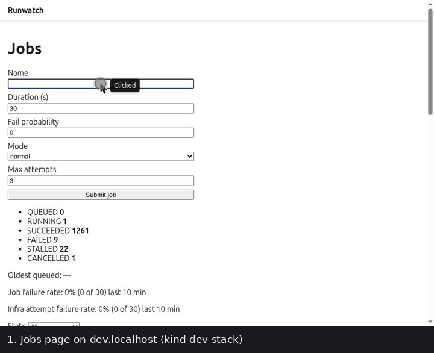](01-job-lifecycle.gif)

GIF 1, about 14 s: `01-job-lifecycle.gif`. Submit a job through the form on
the Jobs page, open it, watch the live logs and the state change to
SUCCEEDED. The job is named `demo-2`, duration 45 s (the frames are sped up).
The QUEUED state lasted under a second here, so it shows only as the QUEUED 1 /
RUNNING 1 counters right after submit; the job page opens already RUNNING.

| Shot | Caption |
| --- | --- |
| 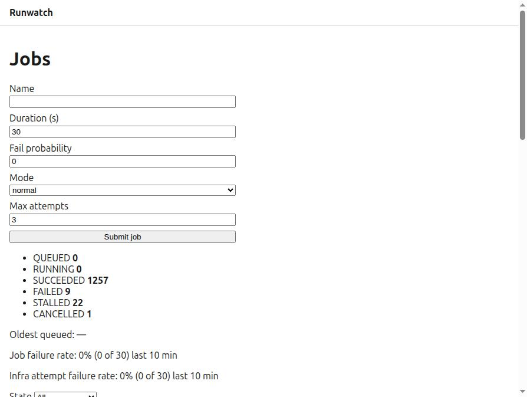 | `01a-jobs-page.jpg`: the Jobs page at `http://dev.localhost` on the kind dev stack: submit form and live counters. |
| 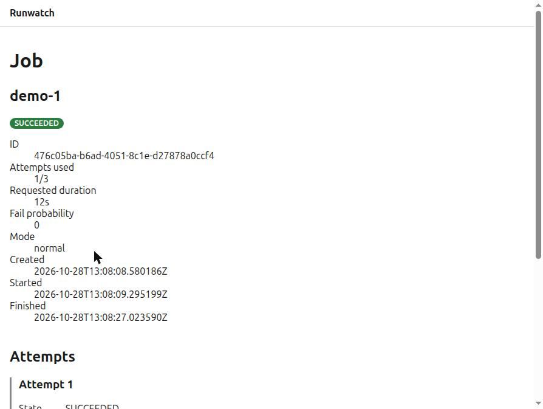 | `01b-job-succeeded.jpg`: the job page of an earlier `demo-1` job: SUCCEEDED, attempt 1/3, created, started and finished times. |

## 2. Grafana: dashboard, logs

| Shot | Caption |
| --- | --- |
| 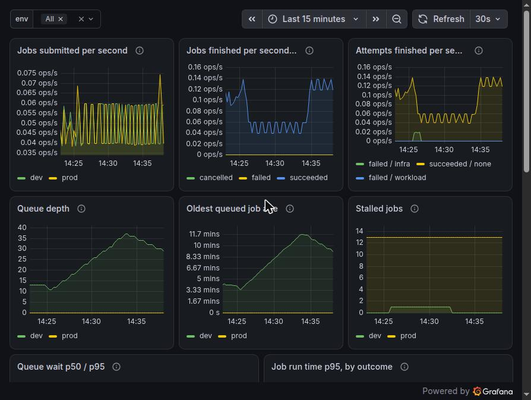 | `02a-grafana-dashboard.jpg`: Runwatch dashboard (15 min, env All), taken after the incident story: queue depth and oldest queued age climb while the worker was down, the Stalled jobs panel shows the dev spike of 1 (and the constant 13 for prod from earlier drills), throughput drops and recovers. |
| 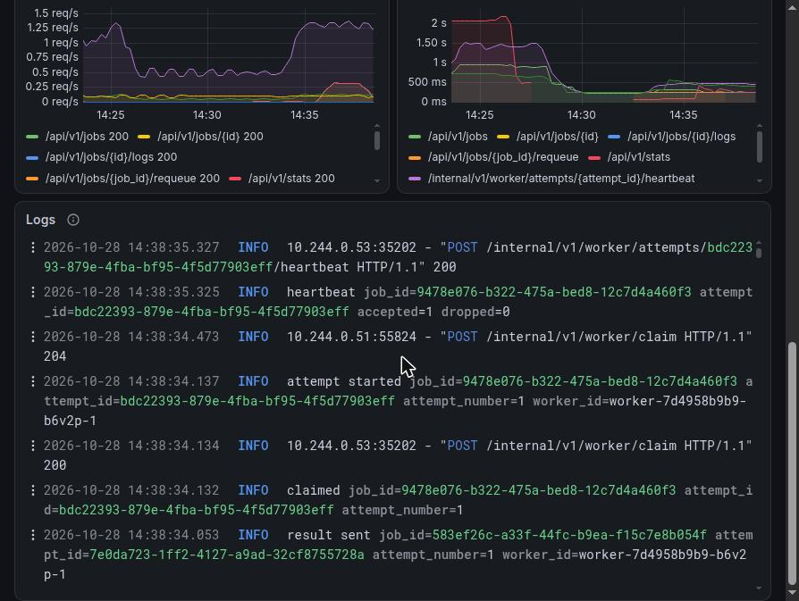 | `02b-grafana-logs.jpg`: the dashboard Logs panel (Loki): API log lines carry only `job_id` and `attempt_id`, never job names. |

## 3. The incident story on dev

Commands (all with the kind kubeconfig, dev only): `DRY_RUN=1 make break-worker`
first (it prints one command, `kubectl -n runwatch-dev scale deployment/worker
--replicas=0`), then `make break-worker` at 13:23:52Z, `make heal` at 13:30Z,
then the stalled job was requeued with `POST /api/v1/jobs/<id>/requeue`.

[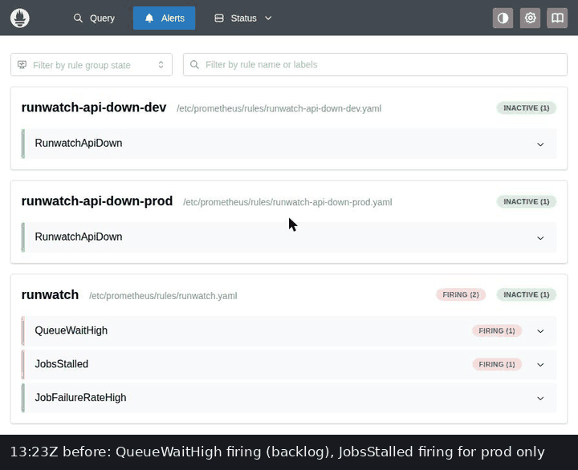](02-incident-alert-to-recovery.gif)

GIF 2, about 16 s: `02-incident-alert-to-recovery.gif`. Alert firing to
recovery, six captured moments (Prometheus alerts page, the agent's report
page, the Jobs page).

| Shot | Caption |
| --- | --- |
| 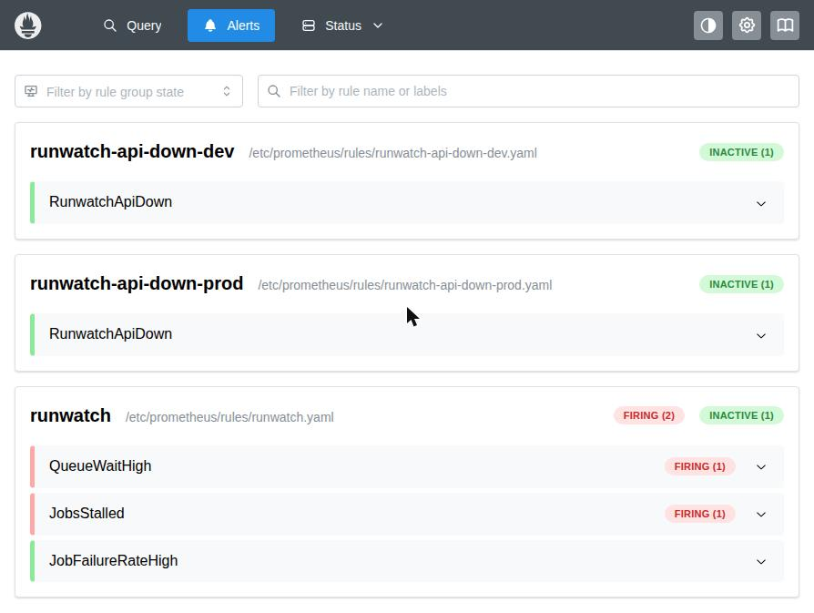 | `03a-alerts-before.jpg`: before the break. `QueueWaitHigh` was already firing for dev (a backlog left by an earlier requeue of stalled load-generator jobs), and `JobsStalled` firing is the stale prod instance (prod is scaled to 0). Not a clean start, said honestly. |
| 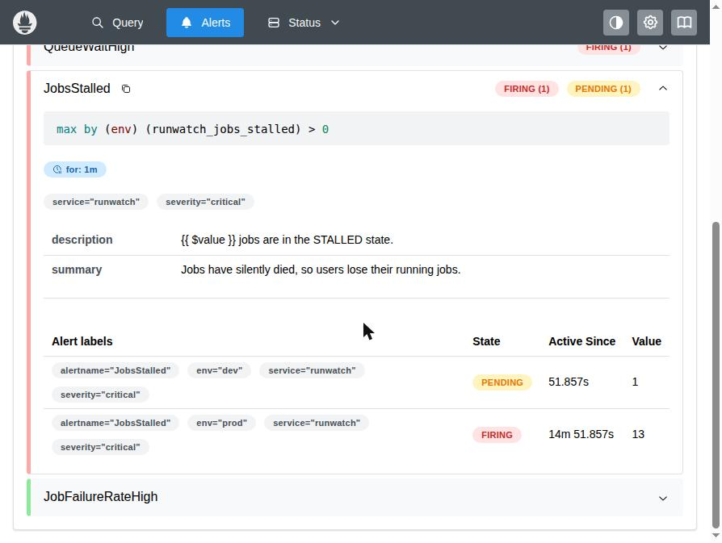 | `03b-jobsstalled-pending.jpg`: 13:25:43Z, about 2 minutes after `make break-worker`, the dev `JobsStalled` instance is PENDING (rule `for: 1m`, value 1). |
| 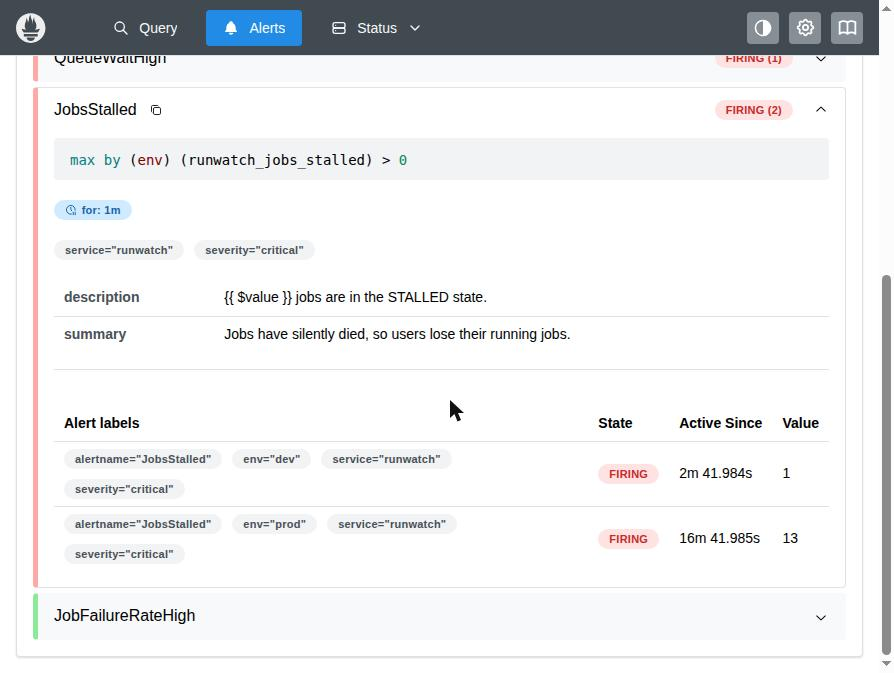 | `03c-jobsstalled-firing.jpg`: about 1 minute later it is FIRING for dev and prod. |
| 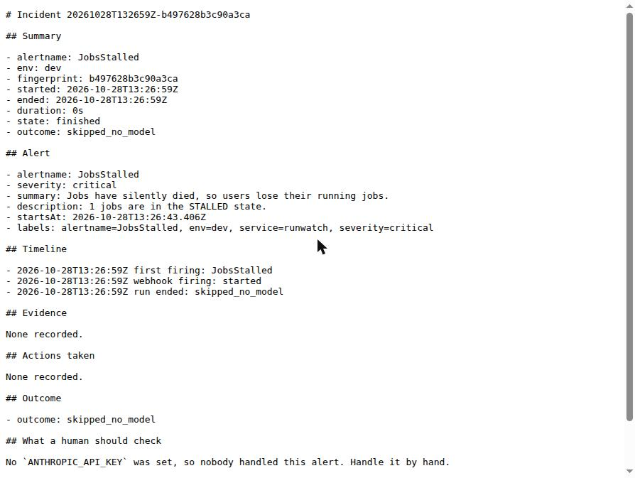 | `03d-agent-report-skipped-no-model.jpg`: the incident report from `GET /incidents/<id>` on the dev agent service (port-forward): `outcome: skipped_no_model`, evidence and actions "None recorded". **There is no model, so nobody diagnosed or fixed anything.** The report is the agent's record that the alert reached it. |
| 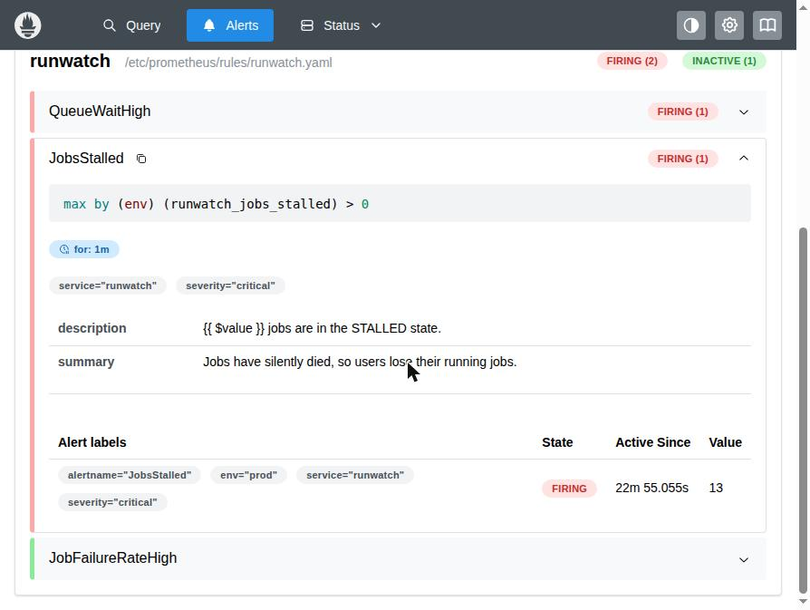 | `03e-jobsstalled-resolved.jpg`: after `make heal` and requeueing the stalled job, the dev `JobsStalled` instance is gone; only the stale prod one remains. |
| 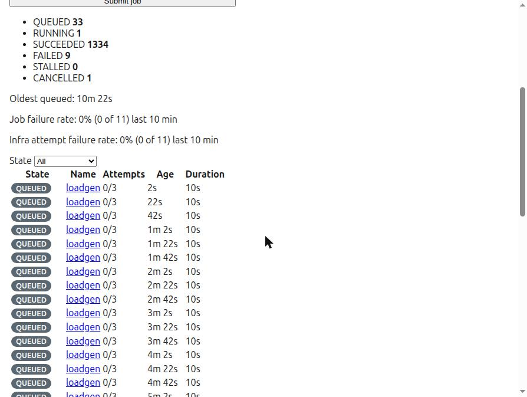 | `03f-jobs-after-heal.jpg`: the Jobs page afterwards: the worker is back, SUCCEEDED keeps growing, STALLED is 0. 33 jobs were still queued: one worker drained the backlog slowly on the loaded VM, so `QueueWaitHigh` had not resolved yet. |

Reports of the earlier no-model drills are in [`incidents/`](../../incidents/README.md).

## 4. CI/CD on GitHub

| Shot | Caption |
| --- | --- |
| 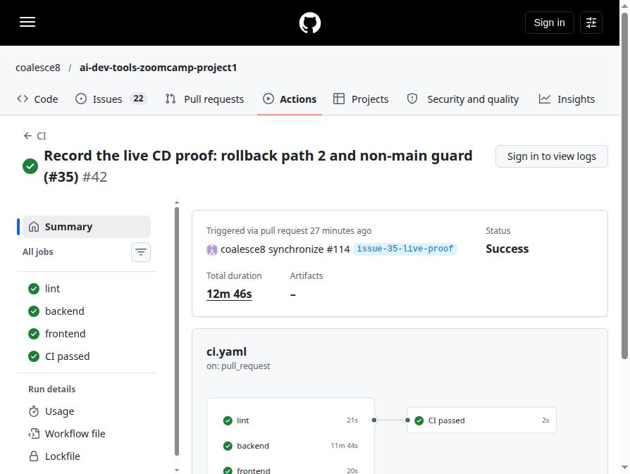 | `04a-ci-run-green.jpg`: a pull request CI run: `lint`, `backend`, `frontend` and `CI passed` all green (the check to wait for). |
| 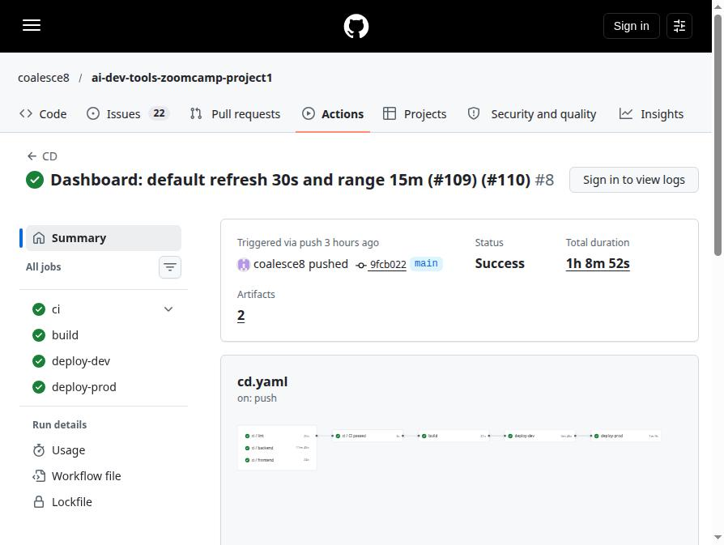 | `04b-cd-run-ci-build-deploy-dev-deploy-prod.jpg`: a completed CD run for a push to `main` (run 40669522952): `ci`, `build`, `deploy-dev` and `deploy-prod` all succeeded, deploy-prod after approval. |
| 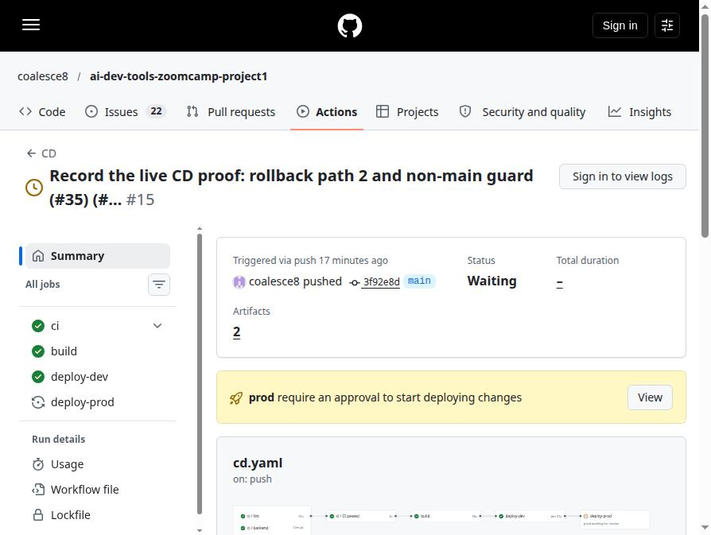 | `04c-cd-prod-approval-gate.jpg`: the CD run of the next push to `main` (run 40691005380): CI, build and `deploy-dev` done, `deploy-prod` Waiting with "prod require an approval to start deploying changes". The owner approves; the agent never does. |
| 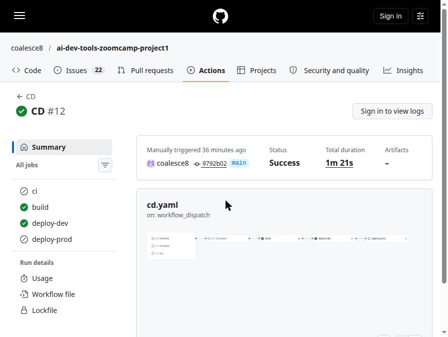 | `04d-cd-rollback-dispatch.jpg`: the rollback dispatch run 40687761011 (rollback path 2: a manual dispatch with `environment=dev` and an earlier `sha`; `build` and `deploy-dev` ran, `ci` and `deploy-prod` were skipped): see [`docs/runbooks/rollback.md`](../runbooks/rollback.md). |

## 5. Work tracked by agents, from the tracker

| Shot | Caption |
| --- | --- |
| 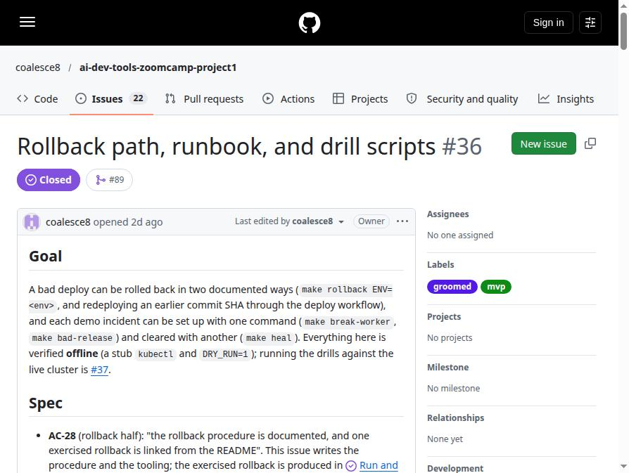 | `05a-issue-with-ac.jpg`: a groomed issue (#36) with Goal, Spec and acceptance criteria (`AC-...`) from [`_docs/SPEC.md`](../../_docs/SPEC.md). |
| 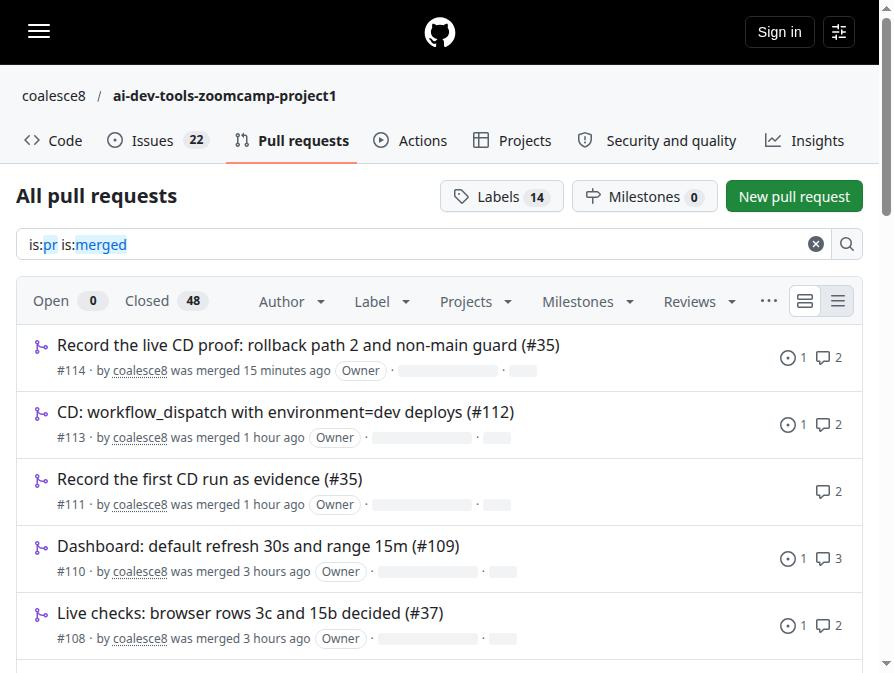 | `05b-merged-prs.jpg`: merged pull requests, one per issue, each with `Closes #n`. |

The one-command run (`docker compose up --build`, Compose and kind never run
together) is described in the top-level [README](../../README.md); it was not
run for this demo.

## What did not work

- Grafana's Tempo "Related logs" and Loki "View trace" jumps were not
  captured. Grafana and Tempo stopped answering for minutes under the VM load
  (Grafana and Tempo pods `0/1` Ready, requests timing out) while Explore was
  needed, so there is no shot of either jump. They are provisioned in
  `observability/grafana/provisioning/datasources/datasources.yaml`.
- The stale `JobsStalled` instance for prod and a backlog on dev made the
  alerts page less clean than a fresh stack would be, and the dev
  `QueueWaitHigh` did not resolve within the recording.
- No live-model run, no prod drill, no real recording: owner steps.
